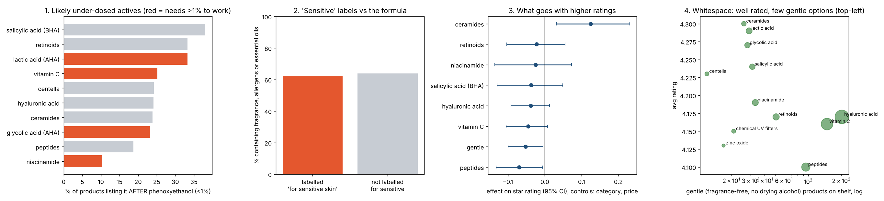

# Actives & Whitespace Lab: Reading 1,231 Skincare Formulas Like a Chemist

[](https://github.com/f20220970-debug/deconstruct-actives-whitespace-lab/actions/workflows/tests.yml)

**[Live demo](https://f20220970-debug.github.io/deconstruct-actives-whitespace-lab/)**: Paste any ingredient list into the formula checker.

## In 30 seconds
- 24% of products are likely under-dosed in actives that need more than 1% to work.
- 62% of products tagged for sensitive skin contain fragrance or allergens.
- Ceramides are the only active linked to higher ratings (+0.13 stars), which matches Deconstruct's own range.


Built exclusively for **Deconstruct's PS-II internship** (Brand & Strategy / Founder's Office). Deconstruct's
promise is skincare that is *safe, sensible and honest*, with a focus on **gentle actives**. This project
asks what the market actually puts in the bottle, where honest and gentle formulas are scarce, and which new
product concept to brief R&D on first, using real ingredient lists rather than marketing claims.

> **Real data, used as a proxy.** 1,472 Sephora skincare products with full ingredient (INCI) lists, price,
> rating and skin-type labels (1,231 with usable lists), plus 10,820 Sephora listings with review counts.
> It's a US prestige retailer, not India: the method transfers to Nykaa, Amazon or quick-commerce data;
> the exact numbers won't.



## The chemistry behind it
An INCI list must show ingredients in **descending order of concentration down to 1%**; below 1% the order is
free. **Phenoxyethanol**, the most common preservative, is capped at **1%** in the EU. So in the 69% of
formulas that contain it, anything listed *after* phenoxyethanol is present at **under 1%**.

That matters only for actives that need more than 1% to work (niacinamide ~2–5%, L-ascorbic acid ~8–20%,
glycolic/lactic acid ~5–10%). Retinol, hyaluronic acid, peptides, ceramides and salicylic acid work at or
below 1%, so for them, coming after phenoxyethanol is normal and I **don't** count it against them.

## Findings
| # | Question | Answer |
| --- | --- | --- |
| 1 | How often is a "hero" active probably under-dosed? | **24% of the time** (135 products) for actives that need >1%: lactic acid 33%, vitamin C 25%, glycolic acid 23%, niacinamide 10%. Under-dosed glycolic products cost *more* (median $66.5 vs $55) and are rated lower (4.02 vs 4.31). |
| 2 | Does "for sensitive skin" mean a gentler formula? | **No.** 62% of products tagged for sensitive skin contain fragrance, fragrance allergens or essential oils, almost the same as products not tagged (64%). |
| 3 | What goes with higher ratings (controlling for category and price)? | **Ceramides: +0.13 stars** (95% CI 0.03–0.23), the only active with a clearly positive link. Gentle formulas rate slightly *lower* (−0.05, CI −0.10 to −0.01): shoppers like how fragrance feels, so a gentle product has to win on texture. |
| 4 | Is "gentle" a premium at Sephora? | No: gentle moisturisers are cheaper (median $42 vs $55), as are gentle treatments ($58 vs $69). Gentle is under-supplied, not over-priced. |
| 5 | Where are well-rated actives short of gentle options? | **Ceramides** (4.30 average rating, only 26 gentle products), **centella** (12), **lactic** and **glycolic acid** (29 and 28), and **mineral zinc-oxide sunscreen** (17). |

**A sanity check that the method works:** the top-ranked concept, a fragrance-free ceramide barrier
moisturiser, is exactly where Deconstruct already plays (Skin Soothe Moisturizer with 1% ceramide, the
Ceramide Moisturizer, the Oats & Ceramide sunscreen). The data rediscovers the brand's own strategy, so its
next picks are worth testing. In a quick check of the website I didn't find a centella product; that's
concept #2 (to confirm with the team).

## Tools built for the NPD team
1. **Formula benchmarking** (`src/benchmark.py`): paste a draft ingredient list, get the closest products
   on the market with price and rating. Ingredients are weighted by position (higher = more concentrated)
   and rarity; "Ceramide NP / AP / EOP / 3" are treated as one ingredient.
   - *Evaluation first:* the 5 nearest formulas predict a product's category 46.5% of the time vs 19.7% for
     always guessing the largest category. Useful, but formulas alone don't separate a moisturiser from an
     eye cream, so **the tool filters to the target category first.**
   - Example: a draft fragrance-free barrier cream finds First Aid Beauty Ultra Repair, Biossance Squalane +
     Omega Repair and Dr. Jart+ Cicapair. The gentle competitors average 4.39 stars at a median $45.
2. **NPD scorecard** (`npd_scorecard.xlsx`, live formulas): 6 concepts scored on data (scarcity of gentle
   options, shopper rating) and judgement (brand fit, R&D ease), with weights you can change.
   Current ranking: ceramide barrier moisturiser, centella calming serum, a properly dosed fragrance-free
   glycolic serum, then a mineral sunscreen.
3. **Concept-test sizing** (same workbook): to detect an 8-point lift in top-2-box purchase intent from 30%,
   a monadic test needs **547 respondents per concept**.
4. **NPD brief** for the #2 concept: [`docs/NPD_brief.md`](docs/NPD_brief.md).

## Run it
```bash
pip install -r requirements.txt
python src/analysis.py        # findings 1-5 -> results/
python src/benchmark.py       # benchmarking tool + its evaluation
python src/build_workbook.py  # -> npd_scorecard.xlsx
python src/plot.py            # -> docs/results.png
pytest -q                     # 4 tests: 1% line, gentle flags, INCI parsing, benchmark matching
```

## Limitations
- US prestige retail, collected around 2018. India's market, price points (₹300–600 for Deconstruct) and
  climate differ.
- The 1% line needs phenoxyethanol in the formula (69% of products); other preservatives have other caps,
  so the remaining 31% are not judged.
- Ratings are averages without review text, so "why" questions (texture, smell, breakouts) need review
  mining or consumer interviews: that's step 1 of the research plan in the brief.
- Ingredient position shows order, not exact percentage. Brands that disclose percentages (as Deconstruct
  does) make this check unnecessary, which is itself a trust advantage worth communicating.

Built by Pavitra Seth (BITS Pilani, M.Sc. Chemistry + B.E. Mechanical) as preparation for Deconstruct's PS-II.
Not affiliated with Deconstruct.
